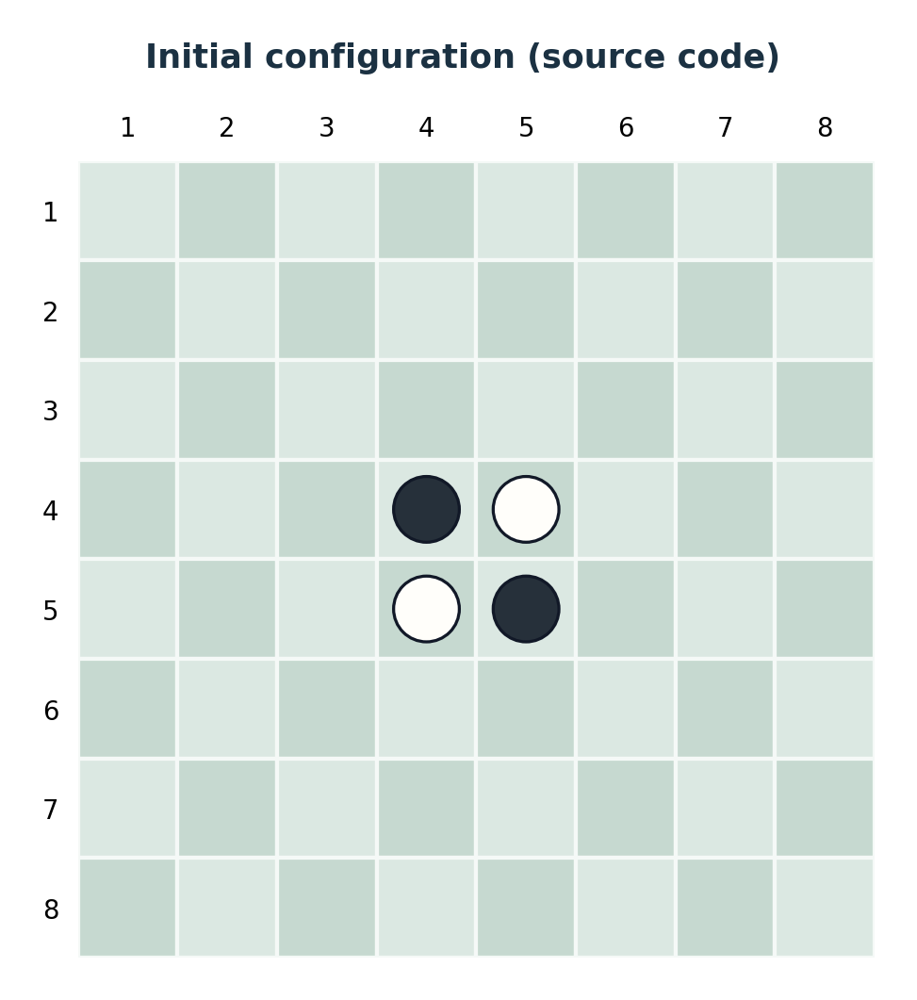
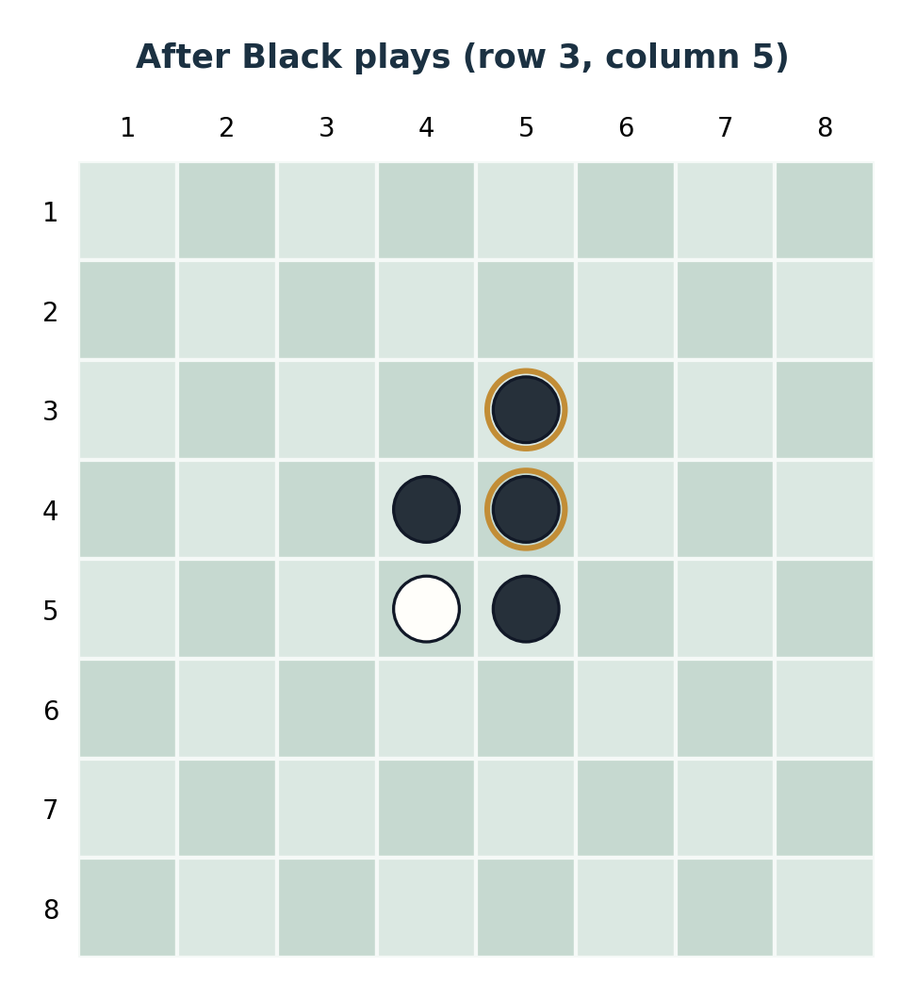

# Othello (Reversi) Game in C++

**Object-oriented programming · 8×8 board game · Directional search · Game-state validation · C++17**

An Othello (Reversi) console-game project documenting a class-based C++ coursework implementation and a **separately developed, tested C++17 portfolio extension**. The original code is preserved unmodified for reference. The extension completes the gameplay loop with legal-move handling, automatic pass turns, end-of-game detection and winner evaluation.

## Academic report

**[Read the full academic report (PDF)](docs/ACADEMIC_REPORT.pdf)** — an English technical report covering the Othello rules, object-oriented architecture, move-validation and disc-flipping algorithms, implementation details, tests, figures, and limitations.

Additional formats: [Markdown report](docs/ACADEMIC_REPORT.md) · [LaTeX source](docs/ACADEMIC_REPORT.tex).



## Project highlights

| Component | Original coursework | Additional portfolio extension |
|---|---|---|
| Board | 8×8 with the four central discs | Fixed-size and safe board representation |
| Move logic | Directional capture checks in eight directions | Bounds-safe legal move generation and flipping |
| Turns and scoring | Two-player alternation and disc counting | Automatic legal pass, game termination and final outcome |
| Interface | Console input and printed board | Validated console input with an exit option |
| Verification | Source-code explanation supplied | C++ assertions and 25 deterministic complete-game tests |

## Gameplay demonstration

The standard opening has two black and two white discs. In the corrected extension, Black can place a disc at **row 3, column 5**, causing one white disc to flip, resulting in a **4–1** count.



## Build and run

Requirements: **C++17 compiler** and **CMake 3.12+**. No third-party C++ libraries are required.

```bash
cmake -S . -B build -DCMAKE_BUILD_TYPE=Debug
cmake --build build
./build/othello
```

On Windows with multi-configuration CMake generators, use `cmake --build build --config Debug` and run the generated `othello.exe` from the corresponding configuration directory.

Enter two integers (row and column, from 1 to 8) or `q` to quit. This is a **local two-human-player game**; it does not include an AI opponent.

## Run automated tests

```bash
ctest --test-dir build --output-on-failure
```

The portfolio extension was tested with assertions enabled and compiler address/undefined-behavior sanitizers. The suite passed initialization, legal-move and invalid-move checks, an opening disc-flip example, turn transitions, and **25 seeded complete-game simulations**. This is not exhaustive proof of correctness.

## Original source and engineering notes

The initial source is in [`archive/original_submission.txt`](archive/original_submission.txt). The original code includes several incomplete or potentially unsafe behaviors: `isGameOver()` always returns `false`, final winner assignment is missing, pass turns are not implemented, row storage grows unnecessarily, and a directional scan can reach outside the board. The **original file has not been rewritten**. The working `src/` files are an explicitly separate improvement, not a claim about the initial coursework's tested completeness.

## Repository structure

```text
othello-cpp-project/
├── README.md
├── CMakeLists.txt
├── .gitignore
├── include/Othello.hpp
├── src/
│   ├── Othello.cpp
│   └── main.cpp
├── tests/test_othello.cpp
├── archive/original_submission.txt
└── docs/
    ├── ACADEMIC_REPORT.pdf
    ├── ACADEMIC_REPORT.md
    ├── ACADEMIC_REPORT.tex
    └── figures/
        ├── initial-board.png
        ├── first-legal-move.png
        └── directional-scan.png
```

## Limitations

No AI, GUI, networking, move undo or performance benchmarks are included. The provided assignment prompt was not available; the report derives its assessment from the submitted C++ code and notes. Historical source and the subsequent corrected engine are deliberately distinguished.

## License

No open-source license has been selected. Please verify any applicable course-publication requirements before redistribution.
