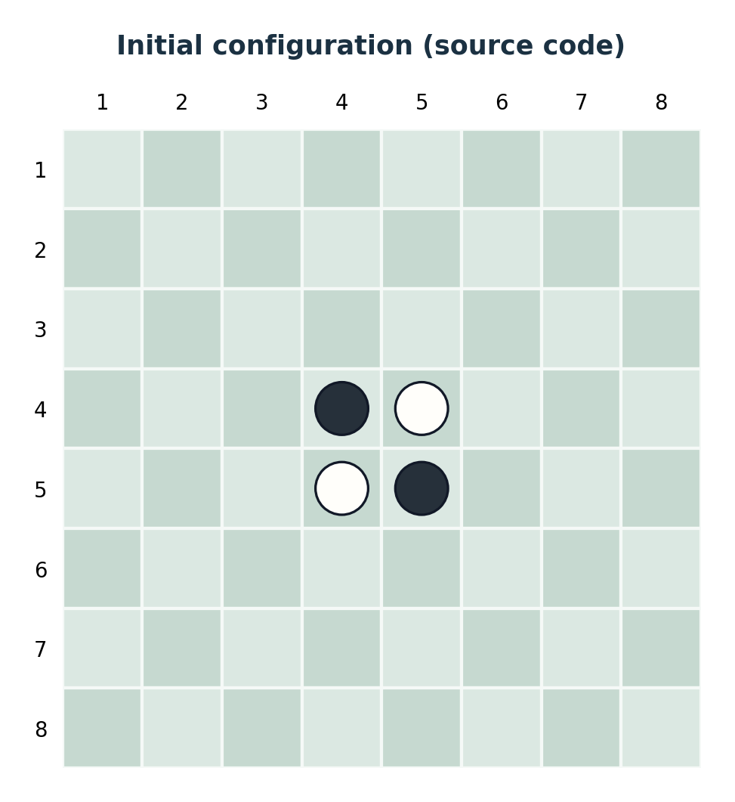
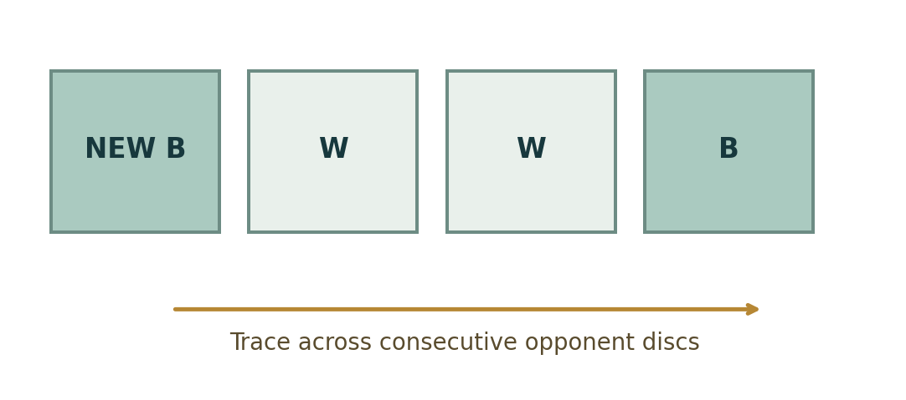
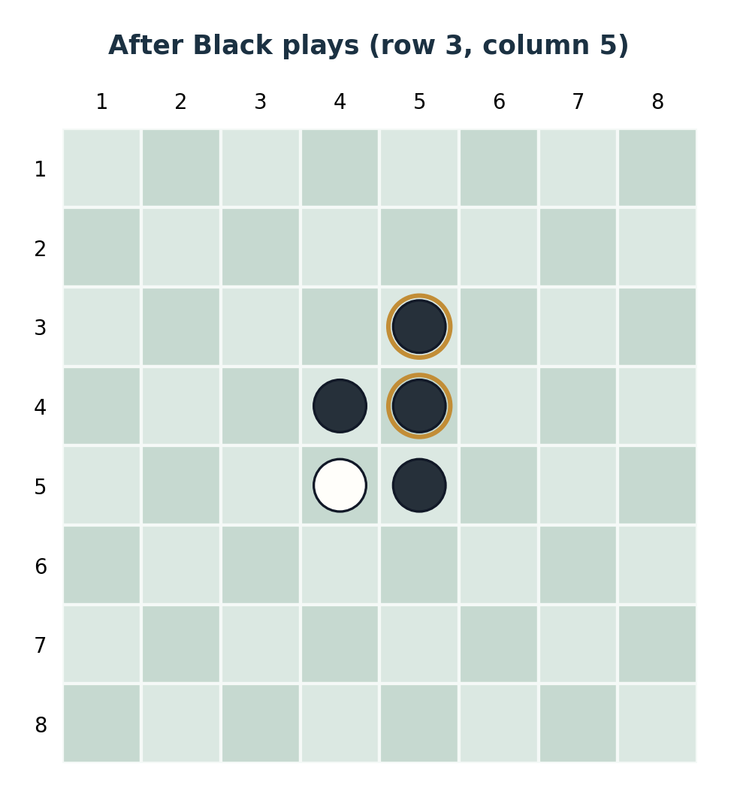

# Othello (Reversi): C++ Game Architecture and Verification

**Author:** Hannaneh Sadat Ahmadi  
**Project:** Object-oriented programming and turn-based game implementation  
**Deliverable:** Source review and independently tested C++17 portfolio extension

> **Provenance:** The initial student C++ program is preserved unchanged in `archive/original_submission.txt`. The working C++17 version in `src/` was prepared separately and must not be mistaken for the original submission. No original question sheet was provided.

## Abstract

The original Othello coursework attempts an 8×8, two-player console game in C++. It initializes the board with four central discs, uses a class to manage player state, checks lines in eight directions for legal captures, places discs and updates color counts. The source has incomplete end-game handling and edge-safety limitations, so the repository additionally includes a clearly labeled, corrected and tested C++17 version. This report documents the architecture, capture conditions, limitations, complexity and tests without claiming the submitted implementation was a finished game.

## 1. Problem and project scope

Othello is a deterministic, perfect-information, two-player game on a fixed board. Players alternate placing discs that bracket one or more opponent discs between a new disc and a disc of their own color. Captured discs change color. A player with no legal move must pass; play ends if neither side can move. The larger disc count at the end wins.

The supplied program is written in **C++**, not Python. It provides the board constructor, a directional capture search, a move validity check, disc flipping, current-player tracking and console output. It does not include AI or a graphical interface.

## 2. Board initialization

The original C++ class uses `vector<vector<char>>`, stores `B` and `W` discs with `-` as empty and creates the opening layout:



It also uses `unordered_map<char,int>` to store disc counts; this map does **not** order the players by score.

## 3. Move legality

For color `p`, a move at `(r,c)` is legal if the destination is empty and at least one directional scan over the 8 neighboring directions encounters one or more opponent discs followed immediately by a disc of color `p` without leaving the board.

```math
\mathrm{Legal}(r,c,p) \iff \mathrm{Empty}(r,c)\land \bigcup_{d\in D} F_d(r,c,p)\neq\varnothing
```



## 4. Original code review

| Item | Evidence-based finding |
|---|---|
| Board construction | The temporary row vector is not cleared between rows, creating unnecessary extra entries. |
| Boundary handling | A directional scan can access the next cell before checking its coordinates. |
| Valid moves and flipping | All eight directions are explicitly considered. |
| Turn passing | No pass mechanism for a player with no legal move. |
| Termination | `isGameOver()` always returns `false`. |
| Winner | Winner field initialized but not assigned a result. |
| Input | Invalid noninteger input / stream closure is not handled robustly. |

The provided text file also includes nonbreaking spaces; compilation of a temporary normalized-whitespace copy is not proof that the submitted original works as a complete game.

## 5. Separate portfolio extension

A C++17 engine has been added under `src/` with a fixed-size board, explicit safe directional scanning, legal-move generation, passing when appropriate, termination, final disc counts and a two-person console interface. It is **new additional work** and does not overwrite the original file.

Black's first move at the 1-based coordinate `(3,5)` creates a valid flip and changes the score from 2–2 to 4–1:



## 6. Validation

The extension was compiled in Debug mode with address and undefined-behavior sanitizers. Its assertion-based C++ test suite passed initialization, boundary, legal-move, disc-flipping, turn-transition and invalid-pass tests. It additionally completed **25 deterministic simulated games**, each checking that occupied-cell counts remained between four and 64. These tests do not establish exhaustive correctness.

```bash
cmake -S . -B build -DCMAKE_BUILD_TYPE=Debug
cmake --build build
ctest --test-dir build --output-on-failure
```

## 7. Complexity

Directional move evaluation requires `O(n)` time for an `n×n` board because at most eight lines of length `n-1` are traversed. Scanning all candidates gives a straightforward `O(n³)` implementation. Board storage is `O(n²)`; on the fixed eight-by-eight board these bounds are small.

## 8. Limitations and next steps

The corrected program supports two players locally but does not implement artificial intelligence, a graphical interface, online play, undo/redo or benchmarking. The supplied original source has known completeness and safety limitations. Reasonable next steps include minimax-based AI, graphical rendering and expanded property-based tests.

## 9. Conclusion

The original work demonstrates class-based game modeling, directional search, input validation and board-state updates in C++. The separately labeled extension illustrates how a coursework prototype can become a reproducible, testable console application without retroactively modifying the original evidence.

For the complete academically formatted report with diagrams, test results and technical discussion, see [ACADEMIC_REPORT.pdf](ACADEMIC_REPORT.pdf).
